<p align="center">
  <picture>
    <source media="(prefers-color-scheme: dark)" srcset="assets/branding/little_captains_hat_logo.svg">
    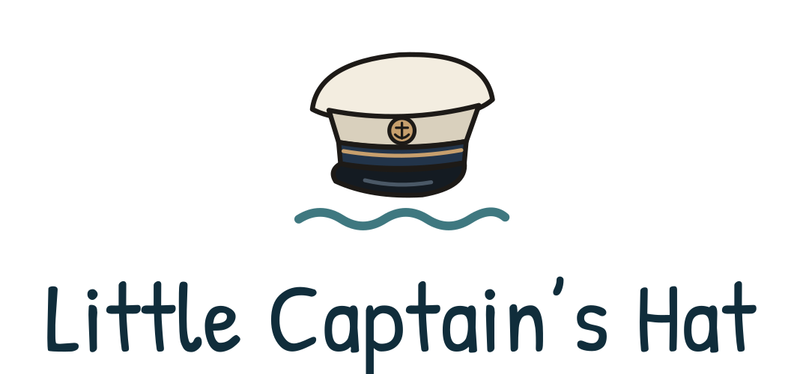
  </picture>
</p>

# Little Captain's Hat

*Small boat. Wide world. Hold onto your hat.*

A cozy 2D sailing adventure about making a home on the water and exploring
the world at your own pace. You live aboard a small cruising sailboat, plan
voyages and prepare for the next destination; the game is not about steering
across every mile of ocean. Sailing is mostly peaceful, the weather can turn
dangerous, and every mishap can be recovered from.

**Little Captain's Hat is the provisional name.** The game was developed as
**Next Harbor** up to Iteration 006. The iteration reports up to
[ITERATION_006_REPORT.md](ITERATION_006_REPORT.md) are historical documents
and keep the old name. Saves from Next Harbor can be imported (see *Saves*).

Current version: **0.105a, Iteration 18: The Joy of the Journey** (see
[ITERATION_18_REPORT.md](ITERATION_18_REPORT.md) and the sea-trial checklist
[WINDOWS_ACCEPTANCE_18.md](WINDOWS_ACCEPTANCE_18.md)). Saves are unchanged
(format 12):
- **Fishing 2.0**: reel a fish in on a dial (press as the needle passes the
  arc; rarer fish need more presses); every species illustrated, blinking
  and flicking its tail; Bronze, Silver and Gold by weight; choose what to
  keep; sharks (always released) and the odd old boot;
- **Sail Trim** (T): trim by hand for a little more speed, or leave it to the
  crew; fewer Long Passage stops for bites;
- **anchorage waypoints** (M on the chart): stop for the night on the way,
  asked once to drop anchor; at anchor the **black ball**, the rode and a
  buoy by day, the **white anchor light** at night;
- the **cat or dog follows you up on deck** in harbour and at anchor;
- warmer pools of lamplight in the cabin, navigation lights on the rail, the
  wind forecast in 1-hour steps up to 6 hours, and a long route that stays on
  the chart while you pan round the world.

Version 0.104a, Iteration 17: Let There Be Light (see
[ITERATION_17_REPORT.md](ITERATION_17_REPORT.md) and
[WINDOWS_ACCEPTANCE_17.md](WINDOWS_ACCEPTANCE_17.md)): day and night,
lamplight and weather sound, the cabin world map, the chart table and the
cockpit chartplotter.

Version 0.103a, Iteration 16: The World Awaits (see
[ITERATION_16_REPORT.md](ITERATION_16_REPORT.md), the sea-trial checklist
[WINDOWS_ACCEPTANCE_16.md](WINDOWS_ACCEPTANCE_16.md) and the guides
[DEV_GUIDES/CHART_REGIONS.md](DEV_GUIDES/CHART_REGIONS.md) and
[DEV_GUIDES/HARBOURS.md](DEV_GUIDES/HARBOURS.md)). The chart now covers the
whole world:
- **a world chart**: press **Whole world** and zoom out to the planet; zoom in
  and Europe, then Denmark, appear in their familiar detail. The world chart is
  a coarser ocean chart from OpenStreetMap coastlines; it wraps round at the
  Date Line, so the Pacific is one ocean;
- **36 harbours abroad**: Madeira, the Azores, the Canaries, Cape Verde and
  Bermuda; the Caribbean from Antigua to Curaçao; Colón and Panama City at the
  ends of the Panama passage; the Galápagos, the Marquesas, Tahiti and the
  Society Islands, the Cook Islands, Samoa, Tonga, Fiji, New Caledonia,
  Hawaii and New Zealand;
- **worldwide courses** that stay off the land, cross the Date Line the
  short way and go through Panama (a gameplay passage, not the real canal);
- **Long Passage time**: on a long voyage a panel on deck shows where you
  are, the distance and ETA, the wind and outlook, the stores and the boat,
  and lets 1, 4 or 12 hours pass each second. It stops by itself for
  arrivals, weather, a bite, the hat, low stores or a boat-care notice;
- **passage stores**: stock up at the grocery store for 32 to 45 days
  depending on the boat; Passage Readiness says when the forecast does not
  reach the whole passage;
- wind and weather for every ocean, warm-water fish, a gentle Go Ashore
  moment in each new region, and seven new Captain's Log firsts on the way to
  Paradise. Saves are unchanged (format 12).

Version 0.102b, revision build "Life at Anchor" (see
[REVISION_0_102B_REPORT.md](REVISION_0_102B_REPORT.md) and the quick check
[WINDOWS_SMOKE_0_102B.md](WINDOWS_SMOKE_0_102B.md)): a small cozy pass. Drop
anchor somewhere sheltered and the boat settles: the evening light goes warm,
the cabin lamp glows, the cat or dog curls up for long naps, and a few quiet
lines come now and then (never repeated). Waking at anchor has its own
morning, and the galley can now **make coffee**: a few minutes and a warm
moment, and the first morning coffee at anchor goes into the Captain's Log.
Saves are unchanged (format 12).

Version 0.102a, Iteration 14: A Bigger World, a Better Boat
(see [ITERATION_14_REPORT.md](ITERATION_14_REPORT.md), the sea-trial checklist
[WINDOWS_ACCEPTANCE_14.md](WINDOWS_ACCEPTANCE_14.md), the developer guides
[DEV_GUIDES/CHART_REGIONS.md](DEV_GUIDES/CHART_REGIONS.md) and
[DEV_GUIDES/BOAT_CARE.md](DEV_GUIDES/BOAT_CARE.md), and the Captain's standing
decisions in [CAPTAINS_ORDERS.md](CAPTAINS_ORDERS.md)):
- **detailed Danish waters**: zoom in on Denmark and the chart shows the
  islands, the Belts and the Øresund from OpenStreetMap coastlines, about six
  times finer than before; routes, harbour approaches, anchoring and fishing
  all follow the detailed coast. Zoomed out it is a light outline like the
  rest of Europe. The chart is built so that more regions can follow;
- **23 more Danish harbours** (Helsingør, Svendborg, Skagen, Rønne,
  Ærøskøbing…), each a small, larger or major service harbour: small ones have
  no boatyard, major ones can haul boats out;
- **boat care**: the hull and bottom, the rigging and sails, the engine and
  the equipment wear slowly with the days, the miles and the wind. The
  Captain's Log has a **Boat** tab with each area in plain words;
- **the boatyard** (**Boat care…**) repairs and services for a price and a
  little time, scaled to the work and the boat; where the yard can lift boats,
  the **haul-out**: a day on the hard, the weed scrubbed off;
- **six pieces of equipment** with real effects (a heavier anchor, a weather
  receiver, a gimballed stove, a large cool box, new rigging, a hard bottom
  coating), each bought once;
- **Passage Readiness**: before setting out, a friendly word on the boat,
  the stores, the weather on the route and the passage's length. Advice only:
  you can always set sail;
- Iteration 13 saves load (format 12); a position the new coast puts on land
  is moved gently to open water.

Version 0.101a, Iteration 13: The Catch & The Cove
(see [ITERATION_13_REPORT.md](ITERATION_13_REPORT.md), the sea-trial checklist
[WINDOWS_ACCEPTANCE_13.md](WINDOWS_ACCEPTANCE_13.md) and the developer guide
[DEV_GUIDES/LIFE_ABOARD.md](DEV_GUIDES/LIFE_ABOARD.md)), brought an evening at sea
without a harbour: *sail, fish, find shelter, anchor, cook, rest, sail on*:
- **fishing**: a rod on the stern rail of every boat and four kinds of lure.
  Fish from a still boat (moored or at anchor) or **troll** a lure behind the
  boat while it sails on. Regional fish from data (herring, mackerel, cod, sea
  trout, perch in the Baltic, bream and bonito in the south…). A bite rings the
  rod's bell and shows **"Fish on!"** in the HUD; then a small, forgiving
  tension game: reel in, and ease off when the bar turns red. Keep the fish in
  the cool box, release it, or sell it at a harbour grocery store;
- a **trophy board** in the cabin with your five most notable catches;
- **the galley**: a little stove beside the provisions. Five simple dishes
  from the catch and the stores; the catch becomes food, and a warm meal
  makes the stores last a little longer. Underway the stove is used only in
  moderate conditions;
- **anchoring**: a windlass on every foredeck. Near a coast it tells you how
  sheltered the spot is from the wind now, you choose the chain and set the
  anchor, and the HUD says how it is holding. If the wind rises, an alarm (a
  red badge, a notice and a soft beep) comes **before** the anchor drags, and
  wakes you if you sleep. Raise it to sail on;
- the day's small stories go into the **Captain's Log** with a little renown
  the first time ("A quiet evening at anchor. Fresh fish for supper.");
- a **new cat and dog**, illustrated like the rest of the boat, that glow
  around their own outline when you can pet them;
- the course view now shows the boat in **eight directions** (N, NE, … NW) and
  follows the captain along the deck; the sailing itself keeps the exact
  course.

Version 0.100c, Iteration 12: A Little Harbour Life, a revision build
(see [ITERATION_12_REPORT.md](ITERATION_12_REPORT.md) and the sea-trial checklist
[WINDOWS_ACCEPTANCE_12.md](WINDOWS_ACCEPTANCE_12.md)), brought:
- **walk ashore**: in harbour a gangplank leads from your boat down to the
  pontoon, where the harbour's services stand: the grocery store, the boatyard
  (where there is one) and **Go Ashore**;
- **Go Ashore**: small, cozy harbour moments (a café, a bench, a friendly
  sailor…) with one or two choices, a little time and the odd euro; the first
  time pays a little renown and becomes a notable moment in the Captain's Log;
- **harbours differ**: services come from data; Copenhagen has all three,
  Lohals (new, on Langeland) has no boatyard;
- the hat's fate is **visible without sound**: a fluttering hat in the HUD when it
  is at risk, "Hat overboard!" when it goes, and a small "Hat missing" badge
  until you buy a new one;
- the object you can use **glows** (the chart table, the berth, the hat hook, a
  sign) instead of a ring around an invisible area;
- underway the **boat faces its course** on screen, north up (Settings →
  *Sailing view* turns it off);
- the shortcut help sits on a dark strip with key caps, readable on any
  background.

Version 0.100b, A Living Little World
(see [VISUAL_POLISH_0100B_REPORT.md](VISUAL_POLISH_0100B_REPORT.md), which ends with a short Windows visual-testing guide), brought:
- a new starter boat, the **Arctic Wanderer 26**: a small tiller-steered sloop
  with a snug one-room cabin. New games start aboard it; the other three boats
  stay one boatyard visit away. Existing saves keep the boat they had;
- the boats have their official names: **Wing 33** (formerly Starling 33),
  **Clam 40** (Halcyon 40) and **Frogleap 36** (Petrel 36); handling, prices,
  sizes and saves are unchanged;
- every boat is illustrated, with **marine teak decks** (long narrow planks,
  dark caulking, margin boards, a king plank and a distinct cockpit sole);
- a more expressive **sailor** with shoulders, arms and hands that swing as
  you walk, with or without the hat;
- **living water**: ripples, wavelets, glints and lapping along the hull and
  the pontoon in harbour, with a few drifting leaves, seaweed or foam chosen by
  the harbour's broad character; at sea, wave crests aligned with the wind and
  livelier as it rises;
- underway the deck view eases out a little to show more sea.

Version 0.100a, Visual Identity V01: A Little Personality
(see [VISUAL_IDENTITY_V01_REPORT.md](VISUAL_IDENTITY_V01_REPORT.md) and [WINDOWS_ACCEPTANCE_VISUAL_V01.md](WINDOWS_ACCEPTANCE_VISUAL_V01.md)), brought:
- the **captain's hat**: it hangs on a hook in every cabin. Wear it (E at the
  hook), take it off (H), and mind the wind on deck: in strong wind it may blow
  away, after a fair warning ("Better hold onto your hat!"). Replacements cost
  €15 at the harbour grocery store;
- seven **secret achievements** about the hat, hidden in the Captain's Log until
  you find them, and short *Notable moments* in the log;
- the new name, logo and a hand-lettered display font (Patrick Hand) for the
  title and decorative headings; Barlow stays the font for everything you read
  closely;
- the game keeps its saves in its own folder, and can copy saves over from Next
  Harbor.

Version numbers follow the convention 0.100a, 0.100b (fixes within a
milestone), 0.101a (the next feature milestone), 0.200a (a large step); see
`src/app/game_version.gd`.

Iteration 006: Making Waves built the loop Sail, arrive, record, earn renown,
publish, get paid, and sail again:
- a **Captain's Log** (**L**, or the pause menu) records your distance,
  voyages, harbours visited, longest passage, rescues and recent passages;
- 16 optional **sailing objectives**, tracked automatically, pay **renown**
  (lifetime renown never decreases);
- **Publish travel update** turns unpublished renown into money (€2 per
  renown), in harbour, from the log or the work station;
- **163 European harbours** (from 15), with a decluttered chart and a
  *Find a harbour…* search.

Earlier iterations built:
- 005c: remote work (€25 an hour) and the paid grocery store;
- 005b: boat condition and weather damage, rescue at sea (€1,000), money, food
  and water, and the October 24 playtest corrections;
- 005a: one deterministic weather model with moving gales, thunderstorms and
  seasonal tropical cyclones;
- 004b: the owner's cat artwork, the refined catamaran cabin, developer guides;
- 004: three boats, the boatyard, sprite-ready vessel art;
- 003b: ship's cat or dog, adjustable sleep, sail check, chart sidebar, simulation
  pause;
- 003: wind, sails, automatic propulsion;
- 002: sea routes, voyages, game clock, weather warnings;
- 001: boat, menus, save/load, settings, audio.

Iteration 005b adds:
- **boat condition** (0-100 %, per boat): Sound, Worn, Damaged, Critical. It is
  shown in the HUD and the boatyard, and drawn as scuffs, cracks and damaged
  planking on deck and below.
- **weather damage**: gales, storms and squall gusts cost condition while
  underway. Ordinary weather and "strong winds" do not. The result is the same
  at any speed, while sleeping and after loading.
- **rescue at sea**: at 0 % one rescue brings you, the boat and the companion
  back to Copenhagen. The boat is repaired, and €1,000 is deducted (never more
  than you have).
- **money**: €10,000 to start, shown in the HUD. The rescue fee is the only cost
  for now.
- **food and water**: 14 days of each, one day used per game day (in harbour
  too). A **provisions station** at every galley shows the days left. The food
  crates and water cans drawn there empty as they are used. There are warnings
  when low, and no departure with empty stores.
- **harbour services**: free **Repair vessel** in the boatyard. Restocking became
  the paid grocery store in Iteration 005c.
- **playtest corrections**: a better-proportioned Halcyon 40 cabin with a
  clearly marked exit; the cat no longer blocks stations (face the cat to pet
  it); a fixed-size boatyard panel.
- **developer test tools** (F10 since Iteration 17, only when run from the Godot editor): test
  storms, squalls, condition levels, the real rescue, stores and time, for
  [WINDOWS_ACCEPTANCE_I005.md](WINDOWS_ACCEPTANCE_I005.md).

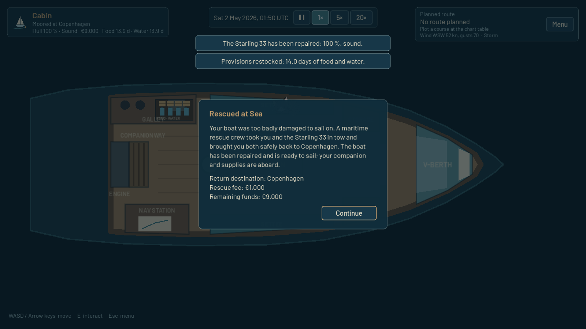
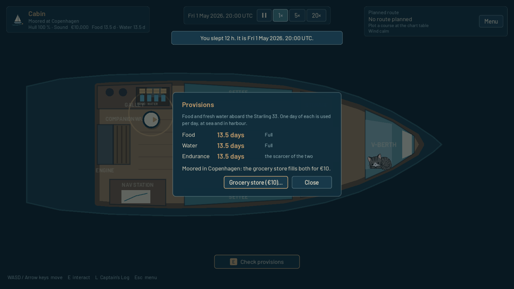
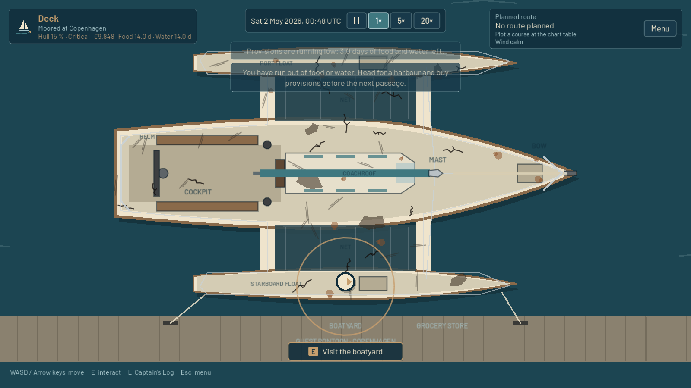

Iteration 005a added:
- **one weather model** (`WeatherModel`): every wind value in the game, from the
  sails to the ETA, comes from it. The old demonstration circles are gone;
- **moving, irregular weather areas**: strong-wind and gale areas over the
  Atlantic, Biscay, North Sea, Baltic, the Mistral and the Meltemi. They form,
  strengthen, drift, change shape and fade over a day or two;
- **thunderstorms**: areas of thunderstorm risk where storm cells develop, peak
  and dissipate within hours, with outflow winds and gust bursts. Strong cells
  are **severe squalls**;
- **hazard levels**: Normal, Caution, Dangerous, Severe, from sustained wind and
  gusts;
- **warnings** at the boat, for storms nearby and for weather up to about
  6 hours ahead on the course. Each is given once, and again only if it gets
  worse. They wake you and drop time to 1×. Storms that have not formed yet
  cannot be foreseen;
- **tropical cyclone seasons** per ocean basin and hemisphere, following the game
  date, and the occasional active cyclone, never in European waters;
- **the chart's weather overlay and Weather tab**: real outlines with labels,
  glyphs and outline styles (not colour alone), a legend, and the hazards along
  the course;
- **storm sounds**: a wind loop that rises with the wind and distant thunder near
  storms (placeholders, on the Ambience bus).

Weather hazards do not damage the boat yet: there is no boat condition, damage,
rescue, money or provisions (planned for Iteration 005b).

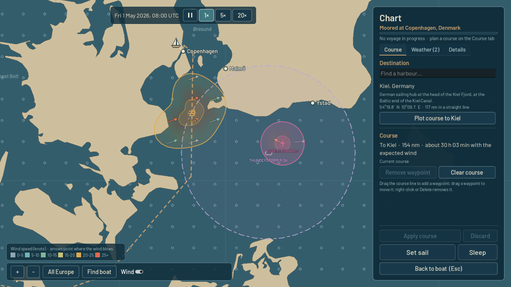
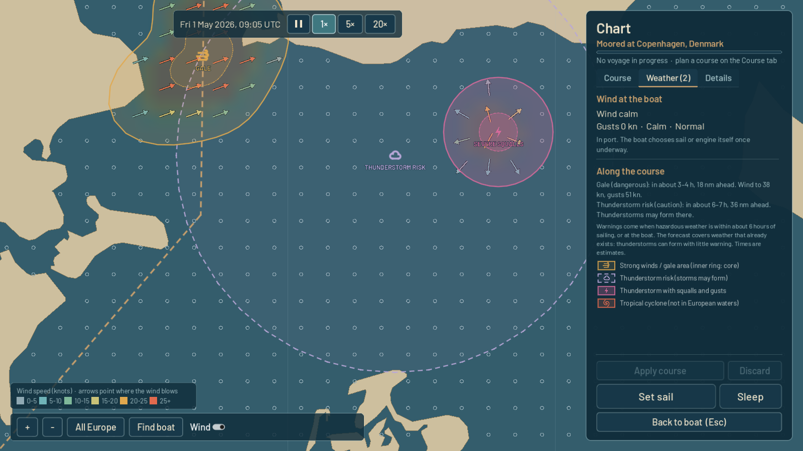

Iteration 004b added:
- **the ship's cat drawn by the owner** (`Visuals/Cat/`). It rests, naps on its
  back, stretches now and then, looks up when you come close, and sits up purring
  with hearts when petted. The poses are configured in data, so the art can be
  replaced without code;
- **a refined Halcyon 40 cabin**: a clearly drawn saloon door to the deck, an
  L-shaped galley, a U-settee with table, a nav station, a full-width owner's
  berth, and a guest cabin with heads, shower and bunk;
- **developer guides** in [DEV_GUIDES/](DEV_GUIDES/README.md): practical
  instructions for sprites, companion poses, vessel art, audio and future
  modding, also readable in the game from the main menu in development builds.

Iteration 004 introduced the Starling 33 monohull, the Halcyon 40 catamaran and
the Petrel 36 trimaran, the boatyard, and named visual slots with procedural
fallback art.

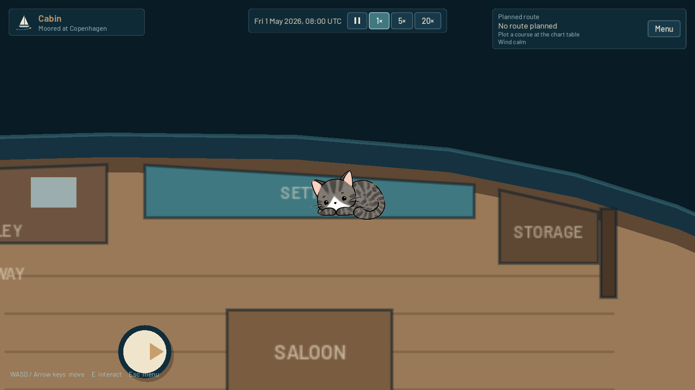
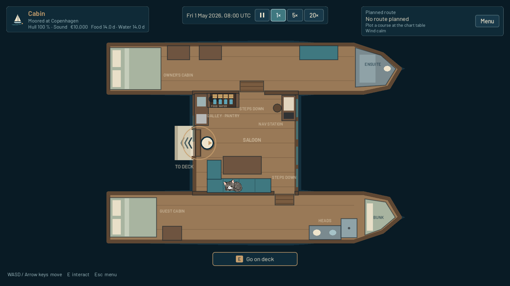
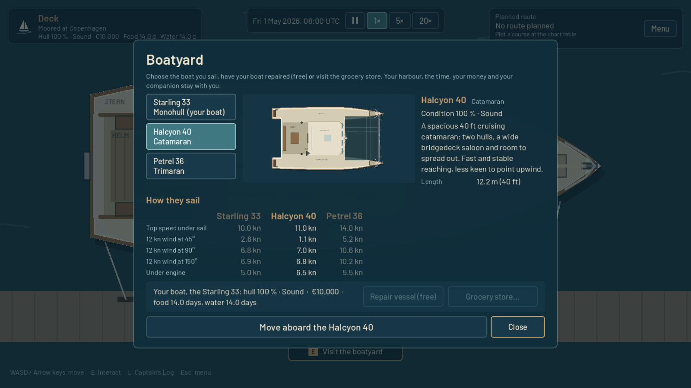
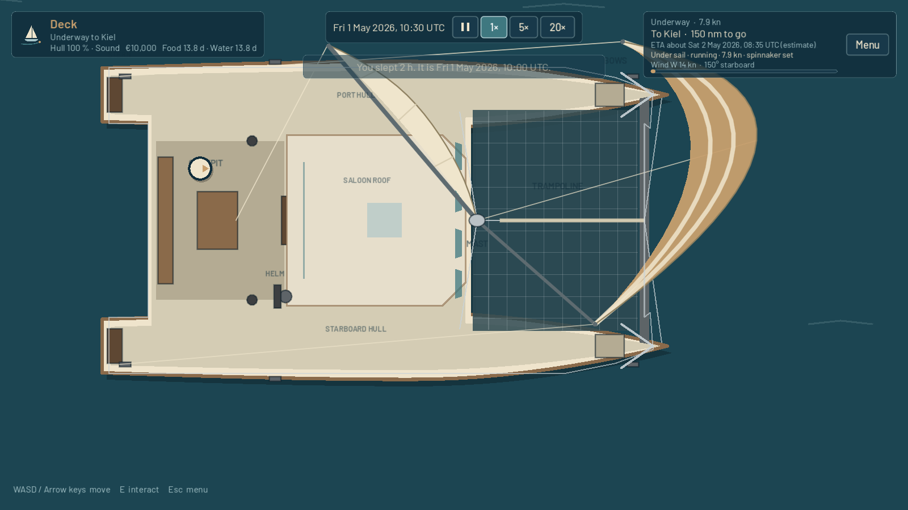
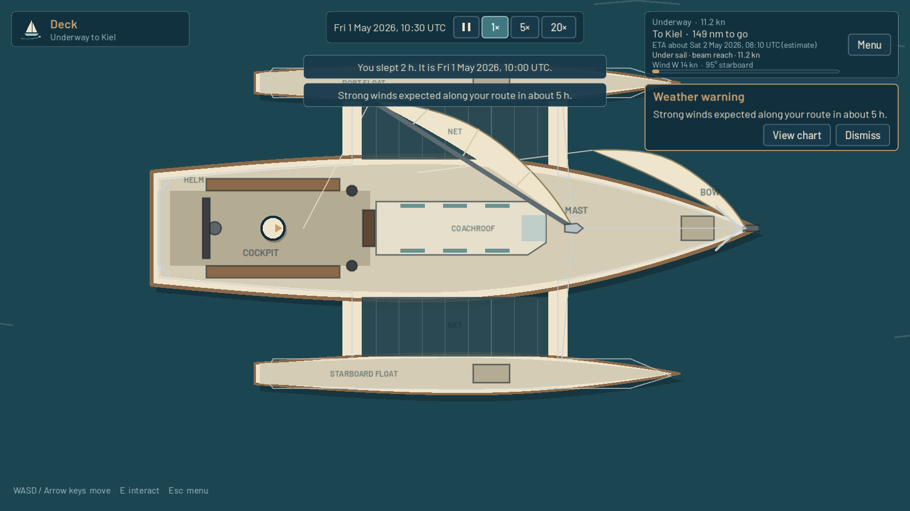
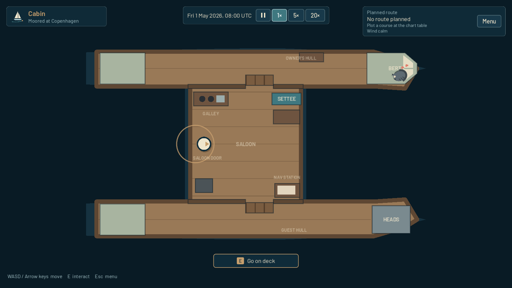

## Engine

- **Godot 4.7.2 (stable)**, GDScript only, no plugins or add-ons.
- Renderer: *Compatibility* (OpenGL 3), the most widely supported option for 2D on Windows.
- Reference resolution 1920×1080, stretch mode `canvas_items` / aspect `expand`.
- Target platform: Windows desktop (developed and tested on Linux, see the iteration reports).

## Opening and running

1. Install [Godot 4.7.x](https://godotengine.org/download) (standard build, not .NET).
2. In the Project Manager choose **Import**, select this folder's `project.godot`, and open it.
   The first import takes a few seconds.
3. Press **F5** (Run Project). The main scene is `res://src/app/app.tscn`.

From the command line:

```sh
godot --path .                                           # run the game
godot --headless --path . res://tests/test_runner.tscn   # run the automated tests
```

## Controls

| Action | Keys / mouse |
|---|---|
| Move | **W A S D** or **arrow keys** |
| Interact | **E** (e.g. pet the cat or dog, sleep at the berth, check the sails at the helm, visit the boatyard from the pontoon side of the deck) |
| Boatyard: browse boats | **Up / Down** (or click a boat), **Move aboard …** to choose |
| Pause menu / back | **Esc** |
| Pause / time acceleration | **Pause** and **1× / 5× / 20×** in the time bar at the top (on deck, in the cabin and on the chart). Pause stops the clock; Pause again, or a speed, continues |
| Chart: pan | drag with the mouse, or **W A S D** / arrows |
| Chart: zoom | mouse wheel, **+ / −**, **Page Up / Page Down**, or the toolbar buttons |
| Chart: choose destination | click a port, then **Plot course to …** |
| Chart: add a waypoint | press on the course line and drag |
| Chart: move a waypoint | drag the diamond-shaped waypoint marker |
| Chart: remove a waypoint | right-click it, or select it and press **Delete** / **Remove waypoint** |
| Chart: show/hide wind | **Wind** switch in the toolbar |
| Chart: sleep | **Sleep** button in the side panel |
| Sleep dialog: duration | **<** / **>** buttons (or Left / Right): 1–12 hours |
| Cat beside a station | stand at the station to use it; **face the cat** (the arrow on your token) to pet it |
| Provisions | **E** at the galley's provisions station (every cabin) |
| Fishing | **E** at the rod on the stern rail (or **R** aboard): let the line out, choose a lure, set what to keep (rarity, size) and what fast time does with bites, wait for a bite |
| Reel in (Iteration 18) | when a fish is on ("Fish on! Reel in"), **R** from anywhere aboard opens the reel; press **E**, **Space/Enter** or click the dial as the needle passes the green arc (the gold middle is Perfect); three misses and it gets away; **Esc** lets it go |
| Sail Trim (Iteration 18) | **T** underway (or the action wheel): **A / D** or arrows ease or sheet in; **Space** leaves it to the crew |
| Chart: anchorage waypoint (Iteration 18) | select a waypoint and press **M** (or **Anchorage**): mark or unmark it as a place to anchor for the night |
| Reduce motion (Iteration 18) | Settings: stills the fish's tail and bob and the buoy |
| Cooking | **E** at the little stove beside the provisions |
| Anchoring | **E** at the windlass on the foredeck; while setting the anchor press **E** (or *Set it now*) as the marker crosses the green middle |
| Trophy board | **E** at the board on the cabin wall |
| Captain's hat | **E** at its hook in the cabin: put it on or hang it up. **H** aboard: take it off (under your arm) or put it back on |
| Captain's Log | **L** (aboard or on the chart), or **Captain's Log** in the pause menu: Log, Harbours and Objectives tabs; *Publish travel update…* |
| Chart: find a harbour | type in **Find a harbour…** on the Course tab, then click a result (works for harbours hidden at the current zoom) |
| Action wheel (Iteration 17) | **Q** aboard: the actions for where you are (helm, cabin, anchor, harbour); arrows or A/D to choose, **E** or Enter to use, **Q** or Esc to close |
| Chartplotter (Iteration 17) | **P** on deck while underway (or from the action wheel); **+ / –** change its range |
| Quicksave / quickload (Iteration 17) | **F5** aboard saves to the quicksave (never a manual slot); **F9** loads it (asks first if you would lose progress); also listed under Load Game |
| Dreamer's Map (Iteration 17) | **E** at the framed world map on the cabin wall: explore the world, read about harbours, *Imagine this voyage*, *Plan it at the chart table* |
| Wind time (Iteration 17, steps changed in Iteration 18) | on the chart: **◀ 1 h / Now / 1 h ▶** under the wind legend (six hours back or ahead; read-only) |
| Developer test tools | **F10** (only when run from the Godot editor; see [WINDOWS_ACCEPTANCE_I005.md](WINDOWS_ACCEPTANCE_I005.md)) |

Menus work with the mouse and keyboard (Tab / arrow keys to move focus, Enter / Space to press).

## Playing a voyage

1. **Plan.** At the **navigation table** in the cabin, press **E** to open the chart of
   Europe. Click a destination port and press **Plot course to …**. The game
   calculates a sea route around coasts and islands, shows its distance and an
   estimated time with the expected wind, and lists any weather along it. The
   chart shows the wind as arrows (pointing where the wind blows) coloured by
   strength; the cursor readout shows the wind under the mouse.

   The sidebar has a header that is always visible (voyage status, distance, ETA)
   and three tabs:
   - **Course:** destination, course and waypoints;
   - **Weather:** the wind at the boat and the weather along the course;
   - **Details:** position, projection and help.

   Its footer always holds **Apply/Change course**, **Discard**, **Set sail**,
   **Sleep** and **Back**.
2. **Adjust (optional).** Drag the course line to add waypoints, drag waypoints to
   move them, right-click to remove them. The legs on either side are recalculated
   at once. A waypoint on land, or a leg that cannot be sailed, is marked **BLOCKED**
   with a red cross and explained in the side panel; such a course cannot be applied.
   Nothing changes until you press **Apply course**. **Discard** returns to the
   current course.
3. **Depart.** Take the **helm** on deck (or press **Set sail** on the chart) and
   confirm. The autopilot sails the course and the boat decides for itself how to
   make way:
   - **Sailing** speed depends on the wind's strength and angle: up to about 10 kn,
     about 3.5 kn in marginal conditions, nothing head to wind.
   - On deck the mainsail and jib are trimmed to the wind on the leeward side.
   - With the wind 115–180° off the bow, the **spinnaker** is set ahead of the bow.
   - When the wind stays too light (averaged over about an hour below 3.5 kn), or
     the boat is becalmed or head to wind for 10 minutes, the **engine** starts:
     5 kn, sails furled, engine sound.
   - The engine stops again once the wind has been good (above 6 kn of sailing
     speed) for a while.

   The HUD shows destination, distance to go, a wind-aware ETA, speed, sail or
   engine with the reason, and the local wind. The pontoon is left behind and the
   chart shows the boat's actual position.

   **Check sail configuration** at the helm (press **E** there while underway) makes
   the boat assess the current heading and wind at once. If the conditions are now
   clearly good or poor, sails or engine change straight away. It is a check, not an
   engine switch: it never forces a mode the conditions don't justify. The usual
   minimum times (15 min under sail, 30 min under engine) still apply, so it cannot
   make the boat switch back and forth. A change of course at sea triggers the same
   check automatically.
4. **Live aboard.** Walk around the cabin and deck while the voyage continues.
   1 real second is 1 game minute at **1×**. Use **5×** or **20×** to go faster, or
   **Pause** to stop the clock: the boat, wind and time wait while you look around
   or plan on the chart. Sleeping still works while paused (it moves time on by the
   hours you choose) and the game stays paused afterwards.
5. **Look after the boat and the crew.** The HUD shows the hull condition,
   money, food and water. Check the stores at the galley's provisions station.
   In harbour, the boatyard's **Boat care** repairs and services the boat for a
   price and a little time (and hauls it out where the yard can). Food and water are
   bought at the **grocery store** on the pontoon (€10 per missing day, food and
   water counted together, up to 14 days each), also reachable from the
   provisions panel and the boatyard. Earn money with **remote work** at the
   cabin's work station while moored: 1–8 hours at €25 per hour; time passes
   and the stores are used as usual. Heavy weather
   at sea costs condition. If it reaches zero you are rescued back to
   Copenhagen for €1,000.
6. **Sleep.** Use the berth in the cabin, or the **Sleep** button on the chart. Choose
   1–12 hours with the arrows. The dialog shows when you will wake. The boat sails
   on while you sleep, and you are woken early on arrival or when a weather warning
   comes in. Wherever you went to sleep, you wake in the cabin beside the V-berth.
7. **Weather.** The chart shows the weather as it is now: strong-wind and gale
   areas, thunderstorm-risk areas, thunderstorms and (outside Europe) tropical
   cyclones, each with its outline, label and symbol, and a legend in the
   Weather tab. Weather moves and changes with time. The boat sails in that
   weather: a gale is a lot of wind. A warning appears with **View chart** and
   **Dismiss** when the weather at the boat becomes hazardous, when a
   thunderstorm is close, or when hazardous weather lies within about
   **6 hours of sailing** on the course. Accelerated time drops back to 1× and a
   sleep is cut short. The forecast only knows weather that already exists:
   a thunderstorm can form with little warning.
8. **Change course at sea.** Open the chart while underway, edit the remaining course
   or pick another destination, and press **Change course**. The new course starts
   where the boat is. If no sea route exists, the current voyage is kept unchanged.
9. **Arrive.** On arrival you get a notification, the HUD shows **Arrived at …**, and
   the next voyage starts from there.

## What works

- **Revision 0.105b, Safe Harbours, Deep Waters & the Sprite Workshop**:
  - **Anchoring worldwide.** The anchor works on suitable coasts everywhere, not just in Denmark. Depths are labelled GAME ESTIMATE.
  - **Anchorage overlay.** An **Anchorages** switch on the chart shows teal (normal anchor) and amber (Magic Anchor) areas when zoomed in on a coast.
  - **The Magic Anchor.** A fictional piece of equipment for deep water, fitted free in Boat care for now. It is set with a small timing dial, holds the boat's position offshore, and gives no shelter.
  - **Engine off at anchor.** The engine stops whenever the anchor goes down.
  - **Solar panels.** Decorative panels on all four boats.
  - **The Sprite Workshop.** `art_replacements/` lets hand-drawn PNGs replace the game's art without code (start with `art_replacements/README_START_HERE.md`).
  - See `REVISION_0_105B_REPORT.md`.

- **Main menu** with the Next Harbor logo: New Game, Continue (most recent valid save),
  Load Game, Settings, Quit.
- **Four boats**, each with its own deck and cabin (all on one level), player movement,
  collision and interactions (berth, navigation table, helm, companionway, boatyard):
  - **Arctic Wanderer 26**, the small monohull you start with (0.100b): tiller steering,
    up to 8 kn under sail, 5 kn under engine;
  - **Wing 33** (internal id `starling_33`, formerly Starling 33), a 33 ft cruising
    sloop: up to 10 kn, 5 kn under engine;
  - **Clam 40** (`halcyon_40`, formerly Halcyon 40), a catamaran with a bridgedeck
    saloon and two hulls: fast reaching, poorer upwind, 6.5 kn under its twin engines;
  - **Frogleap 36** (`petrel_36`, formerly Petrel 36), a trimaran with a central cabin
    hull and two floats: the fastest, up to 14 kn, 5.5 kn under its outboard.
- **Boatyard** (in harbour only): the station by the pontoon opens it. It shows each
  boat's preview, hull type, description, specs and a comparison table (top speed,
  speed in 12 kn of wind at 45°, 90° and 150°, engine speed), all computed from the
  boats' sailing data. Changing boats is free and keeps the time, the harbour, the
  companion and your progress; you step aboard on deck. Underway the boatyard is
  closed.
- **World chart** (Iteration 16): the whole world from OpenStreetMap coastlines,
  wrapping at the Date Line; zoomed in, the **European chart** (Iceland to Cyprus,
  North Cape to North Africa, Natural Earth coastlines) and detailed Denmark take
  over. It has zoom, pan, "Whole world", "Find boat", a cursor coordinate readout
  and **163 harbours** from the Arctic to Cyprus (Iteration 006). Major harbours are
  shown at every zoom; smaller ones appear as you zoom in, and names never overlap.
  Every harbour can be found with the search on the Course tab.
- **Sea routing** that never crosses land, through straits such as the Øresund, Great
  Belt, Dover, Gibraltar and Bonifacio. Routes have editable waypoints,
  and distances are measured along the actual course.
- **Game clock** starting Friday 1 May 2026, 08:00 UTC, with 1× / 5× / 20× acceleration.
  It pauses with the pause menu and runs in the cabin, on deck and on the chart.
- **Voyages**: departure, continuous travel, arrival, sleeping, weather warnings and
  changing course at sea.
- **Weather** (Iteration 005a): one deterministic model for all of Europe and the
  tropical basins. Moving gale areas, thunderstorm risk areas with storm cells
  and gusts, seasonal tropical cyclones; hazard levels Normal / Caution /
  Dangerous / Severe; deduplicated warnings at the boat, nearby and along the
  course; storm sounds. The same weather at 1×, 20×, while sleeping and after
  loading.
- **Wind** for all of Europe (25°W–37°E, 33–72°N): deterministic and continuous,
  changing slowly with time, with plausible regional character. Examples: westerlies
  in the Atlantic, northerlies off Portugal, the Mistral and the Meltemi, and a
  lighter, more changeable Baltic. It is shown on the chart with arrows, a speed
  tint and a legend.
- **Sailing and motoring**: wind-dependent speed (up to ~10 kn), an automatic
  sail/engine choice with hysteresis, an automatic spinnaker, sails drawn on deck
  by wind angle and side, and an engine sound loop (loud on deck, muffled below,
  never restarting on scene changes, following the SFX volume).
- **Ship's companion**: on New Game you choose a **cat** or a **dog** (the cat is
  preselected). It lives in the cabin of whichever boat you sail and rests in a few
  spots of its own, moving to another spot every few game hours.
  - The cat is drawn with the owner's artwork in four poses: resting, napping on
    its back, stretching, and alert.
  - Walk up to it and it looks up. Press **E** to pet it: the cat sits up, purrs
    and shows hearts; the dog pants happily.
  - There are no stats, needs or bonuses; it is company.
- **Captain's Log** (Iteration 006): distance sailed, voyages, harbours visited (of
  163), arrivals, longest passage, rescues, lifetime and unpublished renown, the latest
  50 passages and the harbours visited, all taken from the real voyage events.
- **Objectives and renown**: introductory, exploration, challenge and weather
  objectives (for example: the first hundred miles, 5 harbours, a 200 nm passage,
  a passage without damage, arriving after heavy weather), plus first visits to new
  harbours. Each pays renown once (repeatable ones once per qualifying voyage).
- **Social-media income**: in harbour, *Publish travel update* converts all
  unpublished renown into money at €2 per renown, with a confirmation. Your
  lifetime renown stays.
- **Developer guides** (development builds only): a **Developer guides** button in
  the main menu's top-right corner opens the guides from `DEV_GUIDES/`.
- **Pause menu**, **save/load** (3 slots), **settings** (audio, display, interface scale),
  audio buses and placeholder sounds, as in Iteration 001.

## Saves

- Stored as JSON in the game's own folder: `user://saves/slot_1.json` … `slot_3.json`.
  On Windows that is `%APPDATA%\Little Captains Hat\saves\` (project setting
  `application/config/custom_user_dir_name`, so a future change of name cannot
  move the saves). Settings are `%APPDATA%\Little Captains Hat\settings.cfg`.
- **Saves from Next Harbor** stay where they were:
  `%APPDATA%\Godot\app_userdata\Next Harbor\saves\`. The new game never writes
  there. When saves exist in that folder, the main menu shows **Import Next
  Harbor saves…**. It asks first and then only *copies*: each save goes into the
  slot with the same number if it is free, otherwise into the next free slot,
  otherwise it is skipped and you are told. A slot in use is never overwritten,
  a save already imported is not copied again, and the original files are never
  changed. Old settings are not imported (set them again once).
  To import by hand instead, copy `slot_N.json` from the old folder into the new
  one while the game is closed.
- A save holds everything needed to resume, including mid-voyage:
  - the game clock and time acceleration;
  - the boat's position and status, and the exact course being sailed with the
    progress along it;
  - sail or engine and the automatic controller's state, and the wind seed (the
    weather itself is recomputed from it, so it is the same after loading);
  - the weather warnings already given, and how long the boat has been in its
    current weather (for Iteration 005b);
  - the boat area and player position;
  - the ship's companion (cat or dog, resting spot and when it next moves);
  - the boat you sail (by its stable id, e.g. `halcyon_40`);
  - money, food and water, each boat's condition, and the rescues so far.
- Loading resumes exactly where you saved. **No time passes while the game is closed.**
- Save format version 11 (independent of the game version). **Older saves still load:**
  - Iteration 12 saves (v10) get an empty cool box with the basic rod and two
    spinners, a clean galley record and no anchor down; nothing else changes.
  - Iteration 006 saves (v9 and v8) get the captain's hat: the original, on its hook.
  - Iteration 005a saves (v6) start the new systems as a new game does: €10,000,
    14 days of food and water, every boat at 100 %. A voyage underway is kept.
  - Iteration 004/004b saves (v5) get the new weather section. Their old
    warnings belonged to the retired demonstration areas and are cleared, so
    the new weather is announced normally.
  - Iteration 003b saves (v4) load aboard the Wing 33 (`starling_33`), the starter
    boat of that time, not today's Arctic Wanderer 26.
  - Every save keeps the boat it names; 0.100b changed no save data, only the
    starter boat of *new* games.
  - A save naming a boat this version does not know loads aboard the starter boat
    (the Arctic Wanderer 26), and you are told.
  - Iteration 003 saves (v3) get a ship's cat (the default companion).
  - Iteration 002 saves (v2) keep their voyage. Sail or engine is decided from the
    wind where and when the boat was saved.
  - Iteration 001 saves (v1): the boat is placed in its port at the default start
    time, and an old planned route is recalculated as a sea route. If that is
    impossible, the old route is removed and you are told.
- Writes are safe (temporary file, verify, keep `.bak`, then replace). Damaged or invalid
  saves are reported and never change the running game.

## Diagnostic logs

For bug reports, every run writes a small technical log (not the Captain's
Log): `%APPDATA%\Little Captains Hat\diagnostics\session_<date and time>.jsonl`
on Windows. **Settings → Diagnostic logs…** opens the folder. It records the
game version and commit, screen changes, saving and loading, the captain's hat,
achievements, money, voyages and errors, one line each, never every frame.
The newest 10 sessions are kept, each at most 1 MB. No personal data is written.
Attach the latest file to a bug report.

## Settings

Unchanged from Iteration 001: stored in `user://settings.cfg` (in the game's own folder), separate from saves;
changes preview immediately, **Apply** saves them, **Back** asks before discarding.
Volumes are percentages (0% mutes). Window modes: Windowed, Fullscreen (exclusive),
Borderless fullscreen. Interface scale 80–130% scales menus and HUD only.
**Artwork** (Visual Identity V01): *Illustrated (prototype)* shows the painted
boats (all four since 0.100b), the living water and the illustrated harbours;
*Classic* shows the earlier art, to compare.

## Project layout

```
assets/          branding, fonts (Barlow and Patrick Hand, OFL), the hat's art slots, UI theme, placeholder audio,
                 vessel art folders and templates (assets/vessels/<id>/)
data/navigation/ ports, coastlines, navigation raster and sea-route graph (generated)
data/weather/    weather event zones and cyclone basins (weather_events.json), wind climatology
data/vessel/     sailing performance profiles (polar, engine, controller thresholds)
data/vessels/    vessel definitions, the vessel catalog and visual profiles
src/app/         application shell (main scene) and screen transitions
src/core/        game session state and the simulation (game clock, voyages), provisions, boat condition
src/boat/        boat area logic, collision fixtures, sail rig, visual slots (visuals/)
src/vessels/     vessel definition and catalog; deck/cabin scenes per vessel (<id>/)
src/companion/   ship's companion: state (kind, resting spot), the cabin animal, pose art data types
src/dev/         developer guide index, developer test tools (F10) and weather fixtures
data/companions/ companion pose sets (cat_visuals.tres: pose -> image, placement, timing)
Visuals/Cat/     the owner's original cat drawings (used directly by the game)
DEV_GUIDES/      practical developer guides (sprites, companion, vessel art, audio, modding)
src/player/      player token
src/interaction/ interactables and the player's interaction sensor
src/navigation/  ports, routes, voyages, projection, sea router, chart screen, chart wind layer,
                 weather overlay style and legend
src/sailing/     propulsion state and the automatic sail/engine controller
src/weather/     the weather model, weather events, samples, exposure; the background wind field
src/ui/          menus, HUD, time controls, new-game and sleep dialogs, notifications, dialogs
src/audio/       audio manager
src/persistence/ save manager (format v7 + migration)
src/settings/    settings manager
tests/           self-contained test runner and suites
tools/           generators for the theme, logo exports, placeholder audio, navigation data,
                 vessel scenes, art templates and the demo sprite (tools/vessels/)
docs/            screenshots
```

**Developer guides:** [DEV_GUIDES/README.md](DEV_GUIDES/README.md) is the practical
manual for replacing art and sounds, the companion poses, and the vessel art
templates. **Rule:** whenever an iteration changes an asset workflow or a
documented system, the matching guide is updated in the same iteration.

See [ARCHITECTURE.md](ARCHITECTURE.md) for how it fits together, the release
reports [ITERATION_13_REPORT.md](ITERATION_13_REPORT.md) (0.101a), [ITERATION_12_REPORT.md](ITERATION_12_REPORT.md) (0.100c),
[VISUAL_POLISH_0100B_REPORT.md](VISUAL_POLISH_0100B_REPORT.md) (0.100b) and
[VISUAL_IDENTITY_V01_REPORT.md](VISUAL_IDENTITY_V01_REPORT.md) (0.100a), and
[ITERATION_006_REPORT.md](ITERATION_006_REPORT.md) with its Windows checklist
[WINDOWS_ACCEPTANCE_I006.md](WINDOWS_ACCEPTANCE_I006.md), [005c](ITERATION_005C_REPORT.md),
[005b](ITERATION_005B_REPORT.md), the Windows checklist
[WINDOWS_ACCEPTANCE_I005.md](WINDOWS_ACCEPTANCE_I005.md) (and the reports for
[005a](ITERATION_005A_REPORT.md), [004b](ITERATION_004B_REPORT.md), [004](ITERATION_004_REPORT.md),
[003b](ITERATION_003B_REPORT.md), the [003b hotfix](ITERATION_003B_UI_HOTFIX_REPORT.md),
[003](ITERATION_003_REPORT.md),
[002](ITERATION_002_REPORT.md) and [001](ITERATION_001_REPORT.md)) for what was
built and verified.

## Known limitations

- The world chart (Iteration 16) is a coarse ocean chart (about 5 nm cells):
  narrow channels, lagoons and harbour entrances abroad are not charted, and a
  harbour abroad is reached through an approach of up to 30 nm. Detailed
  regions exist only for Denmark. The Panama passage is an abstraction, not
  the canal. The chart stops at 72° S and 80° N. Harbours abroad have no
  harbour-specific scenery.
- The wind and weather are synthetic, not real weather and not a forecast. Sailing is simplified:
  - there is no manual sail or engine control (the helm only asks for a fresh
    check), no tacking (a head-to-wind leg is motored), and no fuel;
  - there are no currents, depth or tides; the waves drawn around the boat are
    cosmetic and never affect sailing;
  - weather damage is one general condition value; boat care adds slow wear
    of the bottom, rig and engine, but there are no separate breakdowns, and
    there are no waves, rain or visibility effects. Income is remote work and
    travel updates;
  - only Denmark has the detailed chart; elsewhere the coast is the Natural
    Earth outline (about one nautical mile). The chart has no depths, buoys,
    shoals, rocks, shipping lanes or tides anywhere;
  - the chart shows the weather now; it does not animate a forecast;
  - the ETA is an estimate along the route with the expected wind. It ignores the
    controller's delays.
- The companion only rests and changes pose (no walking, no needs) and stays in the
  cabin. Its sounds are synthetic placeholders.
- Fishing, the galley and anchoring are deliberately simple models (see
  [DEV_GUIDES/LIFE_ABOARD.md](DEV_GUIDES/LIFE_ABOARD.md)): fish areas follow the
  nearest harbour's region, not real fish stocks; anchorages are judged only
  from the chart's land/water grid (distance to land and the open water
  upwind), with no depths, seabed or hazards such as rocks; dropping the
  anchor stops the boat at once, and raising it continues the voyage from its
  course. The new sounds are synthetic placeholders too.
- **Routing coverage.** All 163 harbours are reachable (each is tested against the
  chart and router). Waters the chart
  data cannot represent are **not** navigable, and are reported as such instead of being
  crossed. These include:
  - the Black Sea, Sea of Marmara and Sea of Azov (the Bosporus and Dardanelles are too
    narrow for the data);
  - the Gulf of Corinth, the White Sea and the inner Oslofjord;
  - the inner Stockholm archipelago and many small sounds and fjords.

  Oslo, Stockholm and 15 other candidate harbours are therefore not in the list (see
  `tools/navigation/harbours_rejected.csv`). Canals such as the Kiel Canal are not
  modelled.
- Harbour coordinates often sit on generalised coastline. Each port gets a **bounded
  harbour approach**: up to 2 nm from the berth and at most 10 nm through mostly-water
  cells, which may graze the simplified coastline. All other legs stay strictly clear of land.
- The chart and the save files are game data, **not for real navigation**.
- All audio is temporary synthetic test sound. Boat graphics are still procedural
  placeholders: the sprite pipeline is ready, but only one demo sprite exists (the
  Wing 33's coachroof, not enabled by default).
- Boats are only swapped, never bought: money is only used for rescues; there is
  no maintenance, upgrades or decoration yet. The catamaran's and trimaran's layouts are first versions.
- Tested on Linux with Godot 4.7.2 (headless and under a virtual display with software
  OpenGL). Not run on Windows yet. VSync could not be verified in that environment.

## Credits and licences

- Harbour coordinates added in Iteration 006: [UN/LOCODE](https://unece.org/trade/cefact/unlocode-code-list-country-and-territory)
  (UNECE), via the `datasets/un-locode` code list; see `tools/navigation/harbours.csv`.
- Coastlines: [Natural Earth](https://www.naturalearthdata.com/) 1:10m land, public domain.
  Clipped, simplified and rasterised by `tools/navigation/build_navigation_data.py`,
  **not for navigation**.
- World chart coastlines (Iteration 16): map data © [OpenStreetMap](https://www.openstreetmap.org/copyright)
  contributors, ODbL 1.0, via geo-maps earth-lands-100m 0.6.0; international harbour positions
  from the UN/LOCODE code list (UNECE).
- Detailed Danish coastlines (Iteration 14): map data © [OpenStreetMap](https://www.openstreetmap.org/copyright)
  contributors, available under the Open Database License (ODbL 1.0), from the OSM land polygons
  as packaged by geo-maps *earth-lands-100m* 0.6.0 (code MIT). The region files in
  `data/navigation/regions/denmark/` are derived from it and are ODbL too; built by
  `tools/navigation/build_region.py`, **not for navigation**.
- Fine coastal raster for anchoring (Revision 0.105b): map data © [OpenStreetMap](https://www.openstreetmap.org/copyright)
  contributors, ODbL 1.0, from the same geo-maps *earth-lands-100m* 0.6.0 land polygons, rasterised
  at 1/120° by `tools/navigation/build_coast.py` into `data/navigation/coast/` (ODbL, derived
  database). **No real depth data is included**: every depth in the game is a deterministic
  GAME ESTIMATE, **not for navigation**.
- Danish harbour and chart-label positions (Iteration 14): town coordinates from
  [GeoNames](https://www.geonames.org/) (CC BY 4.0) via the lutangar/cities.json list.
- Fonts: [Barlow](https://github.com/jpt/barlow) by Jeremy Tribby, SIL Open Font License
  (`assets/fonts/OFL.txt`); [Patrick Hand](https://github.com/google/fonts/tree/main/ofl/patrickhand)
  by Patrick Wagesreiter, SIL Open Font License (`assets/fonts/OFL-PatrickHand.txt`). See
  `assets/fonts/README.md`.
- Logo, UI, scenes, weather data and placeholder sounds were made for this project.
