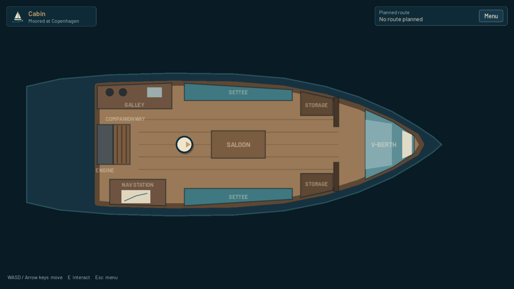

<p align="center">
  <picture>
    <source media="(prefers-color-scheme: dark)" srcset="assets/branding/next_harbor_logo.svg">
    
  </picture>
</p>

# Next Harbor

A 2D liveaboard sailing life simulation. You own a small cruising sailboat and
dream of sailing around the world. The game is about living aboard, planning
voyages and preparing for the next destination, not about steering the boat
across every mile of ocean.

This repository holds **Iteration 001: Core Game Foundation & Visual Identity**,
a small playable foundation: the boat (cabin and deck), a navigation chart with
route planning, save/load, settings, audio routing and the Next Harbor look.



## Engine

- **Godot 4.7.2 (stable)**, GDScript only, no plugins or add-ons.
- Renderer: *Compatibility* (OpenGL 3), the most widely supported option for 2D on Windows.
- Reference resolution 1920×1080, stretch mode `canvas_items` / aspect `expand`.
- Target platform: Windows desktop (developed and tested on Linux, see the iteration report).

## Opening and running

1. Install [Godot 4.7.x](https://godotengine.org/download) (standard build, not .NET).
2. In the Project Manager choose **Import**, select this folder's `project.godot`, and open it.
   The first import takes a few seconds.
3. Press **F5** (Run Project). The main scene is `res://src/app/app.tscn`.

From the command line:

```sh
godot --path .                                     # run the game
godot --headless --path . res://tests/test_runner.tscn   # run the automated tests
```

## Controls

| Action | Keys |
|---|---|
| Move | **W A S D** or **arrow keys** |
| Interact | **E** |
| Pause menu / back | **Esc** |
| Chart: pan | drag with the mouse (any button), or **W A S D** / arrows |
| Chart: zoom | mouse wheel, **+ / −**, **Page Up / Page Down**, or the toolbar buttons |
| Chart: select port | click the port marker |

Menus work with the mouse and keyboard (Tab / arrow keys to move focus, Enter / Space to press).

## What works in this iteration

- **Main menu** with the Next Harbor logo: New Game, Continue (most recent valid save,
  disabled when there is none), Load Game, Settings, Quit.
- **The boat**, a ~33 ft cruising sloop in two separate scenes:
  - *Cabin*: companionway, engine access, galley, navigation table, saloon (settees and table),
    storage lockers and a V-berth.
  - *Deck*: cockpit, helm, coachroof with companionway hatch, mast, side decks, bow and stern,
    moored alongside a pontoon in Copenhagen.
- **Player** token with WASD/arrow movement, normalized diagonals and collision with the hull and furniture.
- **Interactions** (press E when the prompt appears):
  - *Berth*: says that sleeping is not implemented yet.
  - *Helm*: says that steering/sailing is not implemented yet.
  - *Navigation table*: opens the chart.
  - *Companionway*: moves between cabin and deck.
- **Chart** of the Western Baltic built from real coastline data (Natural Earth, simplified):
  zoom, pan, the boat's position, selectable ports (Copenhagen, Kiel), plotting, changing
  and clearing a course. The planned route is part of the saved game.
- **HUD** with the current area and location, the planned route, the interaction prompt,
  notifications and a Menu button.
- **Pause menu** (Esc): Resume, Save Game, Load Game, Settings, Return to Main Menu.
  Gameplay pauses while it is open.
- **Save / load** with three manual slots, showing time, area, location and destination.
- **Settings**: five volume sliders with test buttons, window mode, VSync, interface scale,
  Restore Defaults, Apply and Back.

## Saves

- Stored as JSON in Godot's user folder: `user://saves/slot_1.json` … `slot_3.json`.
  On Windows that is `%APPDATA%\Godot\app_userdata\Next Harbor\saves\`.
- Each file contains a format id, a format version, the save time and the session state
  (boat area, player position or spawn point, current location id, planned route).
- Writes go to a temporary file first, which is read back and checked. The previous save is
  then kept as `slot_N.json.bak` and the new file is moved into place, so a failed write never
  destroys the last good save.
- Damaged, incomplete or newer-version saves are shown as such in the slot list and cannot be
  loaded. A failed load changes nothing in the running game.
- **New Game never writes to a slot.** Continue loads the newest valid slot.

## Settings

- Stored in `user://settings.cfg` (ConfigFile), separate from saves. Missing or invalid values
  fall back to defaults.
- Changes preview immediately. **Apply** saves them. **Back** with unapplied changes asks whether
  to discard them, and discarding restores the last applied values. **Restore Defaults** resets
  everything; press Apply to keep the defaults.
- Volumes are percentages. 0% mutes the bus; other values map to decibels with `linear_to_db`.
- Window modes: Windowed (1600×900, clamped to the screen), Fullscreen (exclusive) and Borderless
  fullscreen. Window mode cannot be changed while the game runs embedded in the editor's game view.
- Interface scale (80–130%) scales menus and HUD only, not the game world.

## Project layout

```
assets/        branding (SVG logo + PNG exports), fonts (Barlow, OFL), UI theme, placeholder audio
data/          port resources and the chart's coastline data
src/app/       application shell (main scene) and screen transitions
src/core/      game session state
src/boat/      cabin and deck scenes, boat area logic, fixture geometry
src/player/    player token
src/interaction/  interactables and the player's interaction sensor
src/navigation/   ports, routes, projection, chart screen
src/ui/        menus, HUD, notifications, dialogs
src/audio/     audio manager
src/persistence/  save manager
src/settings/  settings manager
tests/         self-contained test runner and suites
tools/         scripts that regenerate the theme, logo exports and placeholder audio
docs/          screenshots
```

See [ARCHITECTURE.md](ARCHITECTURE.md) for how it fits together and
[ITERATION_001_REPORT.md](ITERATION_001_REPORT.md) for what was verified.

## Known limitations

- No sailing, travel, time, weather, economy or needs. Bed and helm only show a message (by design for this iteration).
- Routes are a direct origin → destination line. It is drawn straight and can cross land
  (Copenhagen → Kiel crosses Zealand); intermediate waypoints are supported in the data
  format but cannot be placed yet.
- The chart covers only the Western Baltic and has two ports.
- The chart cannot be saved from directly: close it (Esc) and use the pause menu.
- All audio is temporary synthetic test sound (see `assets/audio/placeholder/README.md`). No music plays by default.
- Boat graphics are simple placeholder geometry.
- Tested on Linux with Godot 4.7.2 (headless and under a virtual display). Not run on Windows yet.

## Credits and licences

- Coastlines: [Natural Earth](https://www.naturalearthdata.com/) 1:10m land, public domain.
  Clipped and simplified, **not for navigation**.
- Font: [Barlow](https://github.com/jpt/barlow) by Jeremy Tribby, SIL Open Font License
  (`assets/fonts/OFL.txt`).
- Logo, UI, scenes and placeholder sounds were made for this project.
