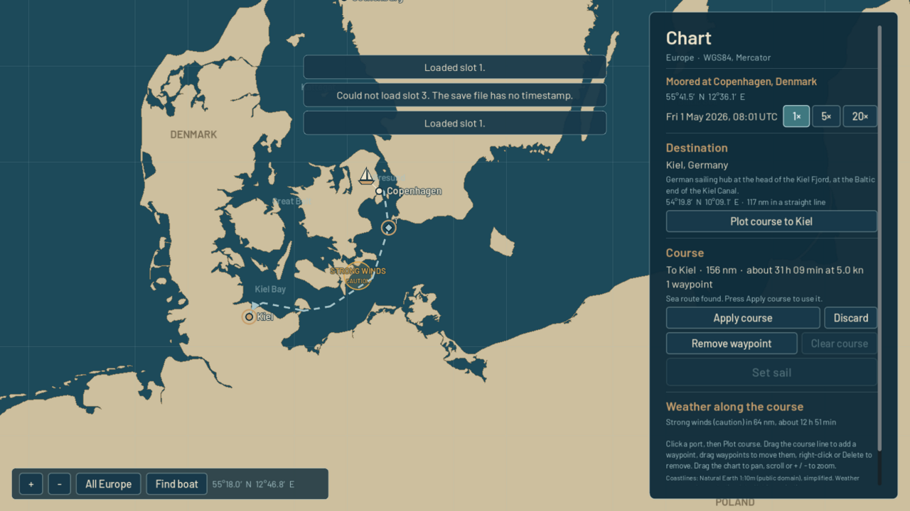

<p align="center">
  <picture>
    <source media="(prefers-color-scheme: dark)" srcset="assets/branding/next_harbor_logo.svg">
    
  </picture>
</p>

# Next Harbor

A 2D liveaboard sailing life simulation. You own a small cruising sailboat and
dream of sailing around the world. The game is about living aboard, planning
voyages and preparing for the next destination, not about steering the boat
across every mile of ocean.

Current state: **Iteration 002: The First Voyage**, built on Iteration 001
(boat, menus, save/load, settings, audio, visual identity). You can plan
sea routes across Europe on the chart, sail them in game time, sleep while the
autopilot sails on, react to weather warnings by changing course at sea, and
arrive in the next harbour.



## Engine

- **Godot 4.7.2 (stable)**, GDScript only, no plugins or add-ons.
- Renderer: *Compatibility* (OpenGL 3), the most widely supported option for 2D on Windows.
- Reference resolution 1920×1080, stretch mode `canvas_items` / aspect `expand`.
- Target platform: Windows desktop (developed and tested on Linux, see the iteration reports).

## Opening and running

1. Install [Godot 4.7.x](https://godotengine.org/download) (standard build, not .NET).
2. In the Project Manager choose **Import**, select this folder's `project.godot`, and open it.
   The first import takes a few seconds.
3. Press **F5** (Run Project). The main scene is `res://src/app/app.tscn`.

From the command line:

```sh
godot --path .                                           # run the game
godot --headless --path . res://tests/test_runner.tscn   # run the automated tests
```

## Controls

| Action | Keys / mouse |
|---|---|
| Move | **W A S D** or **arrow keys** |
| Interact | **E** |
| Pause menu / back | **Esc** |
| Time acceleration | **1× / 5× / 20×** buttons at the top of the screen (also on the chart) |
| Chart: pan | drag with the mouse, or **W A S D** / arrows |
| Chart: zoom | mouse wheel, **+ / −**, **Page Up / Page Down**, or the toolbar buttons |
| Chart: choose destination | click a port, then **Plot course to …** |
| Chart: add a waypoint | press on the course line and drag |
| Chart: move a waypoint | drag the diamond-shaped waypoint marker |
| Chart: remove a waypoint | right-click it, or select it and press **Delete** / **Remove waypoint** |

Menus work with the mouse and keyboard (Tab / arrow keys to move focus, Enter / Space to press).

## Playing a voyage

1. **Plan.** At the **navigation table** in the cabin, press **E** to open the chart of
   Europe. Click a destination port and press **Plot course to …**. The game
   calculates a sea route around coasts and islands, shows its distance and
   sailing time, and lists any weather along it.
2. **Adjust (optional).** Drag the course line to add waypoints, drag waypoints to
   move them, right-click to remove them. The legs on either side are recalculated
   at once. A waypoint on land, or a leg that cannot be sailed, is marked **BLOCKED**
   with a red cross and explained in the side panel; such a course cannot be applied.
   Nothing changes until you press **Apply course**. **Discard** returns to the
   current course.
3. **Depart.** Take the **helm** on deck (or press **Set sail** on the chart) and
   confirm. The boat sails at a constant 5 knots on autopilot. The pontoon is left
   behind, the HUD shows destination, distance to go and ETA, and the chart shows
   the boat's actual position.
4. **Live aboard.** Walk around the cabin and deck while the voyage continues.
   1 real second is 1 game minute at **1×**. Use **5×** or **20×** to go faster.
5. **Sleep.** Use the berth to sleep 4, 6 or 8 hours. The boat sails on while you
   sleep, and you are woken early on arrival or when a weather warning comes in.
6. **Weather.** The chart shows demonstration weather areas (fair, caution, danger).
   When your course will reach a caution or danger area within **5 hours of sailing**,
   a warning appears with **View chart** and **Dismiss**. Accelerated time drops back
   to 1×. Weather has no other effect in this iteration.
7. **Change course at sea.** Open the chart while underway, edit the remaining course
   or pick another destination, and press **Change course**. The new course starts
   where the boat is. If no sea route exists, the current voyage is kept unchanged.
8. **Arrive.** On arrival you get a notification, the HUD shows **Arrived at …**, and
   the next voyage starts from there.

## What works

- **Main menu** with the Next Harbor logo: New Game, Continue (most recent valid save),
  Load Game, Settings, Quit.
- **The boat**, a ~33 ft cruising sloop in two separate scenes (cabin and deck), with
  player movement, collision and interactions (berth, navigation table, helm, companionway).
- **European chart** (Iceland to Cyprus, North Cape to North Africa) from Natural Earth
  coastlines. It has zoom, pan, "All Europe", "Find boat", a cursor coordinate readout
  and **15 ports**: Copenhagen, Kiel, Gothenburg, Bergen, Helsinki, Portsmouth, Dublin,
  Brest, Lisbon, Gibraltar, Barcelona, Marseille, Naples, Piraeus and Reykjavík.
- **Sea routing** that never crosses land, through straits such as the Øresund, Great
  Belt, Dover, Gibraltar and Bonifacio. Routes have editable waypoints,
  and distances are measured along the actual course.
- **Game clock** starting Friday 1 May 2026, 08:00 UTC, with 1× / 5× / 20× acceleration.
  It pauses with the pause menu and runs in the cabin, on deck and on the chart.
- **Voyages**: departure, continuous travel, arrival, sleeping, weather warnings and
  changing course at sea.
- **Pause menu**, **save/load** (3 slots), **settings** (audio, display, interface scale),
  audio buses and placeholder sounds, as in Iteration 001.

## Saves

- Stored as JSON in Godot's user folder: `user://saves/slot_1.json` … `slot_3.json`.
  On Windows that is `%APPDATA%\Godot\app_userdata\Next Harbor\saves\`.
- A save holds everything needed to resume, including mid-voyage:
  - the game clock and time acceleration;
  - the boat's position and status, and the exact course being sailed with the
    progress along it;
  - the weather warnings already given;
  - the boat area and player position.
- Loading resumes exactly where you saved. **No time passes while the game is closed.**
- Save format version 2. **Saves from Iteration 001 still load:** the boat is placed in
  its port at the default start time, and an old planned route is recalculated as a sea
  route. If that is impossible, the old route is removed and you are told.
- Writes are safe (temporary file, verify, keep `.bak`, then replace). Damaged or invalid
  saves are reported and never change the running game.

## Settings

Unchanged from Iteration 001: stored in `user://settings.cfg`, separate from saves;
changes preview immediately, **Apply** saves them, **Back** asks before discarding.
Volumes are percentages (0% mutes). Window modes: Windowed, Fullscreen (exclusive),
Borderless fullscreen. Interface scale 80–130% scales menus and HUD only.

## Project layout

```
assets/          branding, fonts (Barlow, OFL), UI theme, placeholder audio
data/navigation/ ports, coastlines, navigation raster and sea-route graph (generated)
data/weather/    demonstration weather areas
data/vessel/     vessel profile (cruising speed)
src/app/         application shell (main scene) and screen transitions
src/core/        game session state and the simulation (game clock, voyages)
src/boat/        cabin and deck scenes, boat area logic, fixture geometry
src/player/      player token
src/interaction/ interactables and the player's interaction sensor
src/navigation/  ports, routes, voyages, projection, sea router, chart screen
src/weather/     weather conditions
src/ui/          menus, HUD, time controls, sleep dialog, notifications, dialogs
src/audio/       audio manager
src/persistence/ save manager (format v2 + migration)
src/settings/    settings manager
tests/           self-contained test runner and suites
tools/           generators for the theme, logo exports, placeholder audio and navigation data
docs/            screenshots
```

See [ARCHITECTURE.md](ARCHITECTURE.md) for how it fits together, and
[ITERATION_002_REPORT.md](ITERATION_002_REPORT.md) (and
[ITERATION_001_REPORT.md](ITERATION_001_REPORT.md)) for what was built and verified.

## Known limitations

- Sailing is deliberately simple: a constant 5 knots, no wind, currents, depth or tides.
  Weather areas are static demonstration data and only produce warnings.
- **Routing coverage.** All 15 ports are reachable from each other. Waters the chart
  data cannot represent are **not** navigable, and are reported as such instead of being
  crossed. These include:
  - the Black Sea, Sea of Marmara and Sea of Azov (the Bosporus and Dardanelles are too
    narrow for the data);
  - the Gulf of Corinth, the White Sea and the inner Oslofjord;
  - the inner Stockholm archipelago and many small sounds and fjords.

  Oslo and Stockholm are therefore not in the port list. Canals such as the Kiel Canal
  are not modelled.
- Harbour coordinates often sit on generalised coastline. Each port gets a **bounded
  harbour approach**: up to 2 nm from the berth and at most 10 nm through mostly-water
  cells, which may graze the simplified coastline. All other legs stay strictly clear of land.
- The chart and the save files are game data, **not for real navigation**.
- All audio is temporary synthetic test sound. Boat graphics are simple placeholders.
- Tested on Linux with Godot 4.7.2 (headless and under a virtual display with software
  OpenGL). Not run on Windows yet. VSync could not be verified in that environment.

## Credits and licences

- Coastlines: [Natural Earth](https://www.naturalearthdata.com/) 1:10m land, public domain.
  Clipped, simplified and rasterised by `tools/navigation/build_navigation_data.py`,
  **not for navigation**.
- Font: [Barlow](https://github.com/jpt/barlow) by Jeremy Tribby, SIL Open Font License
  (`assets/fonts/OFL.txt`).
- Logo, UI, scenes, weather areas and placeholder sounds were made for this project.
