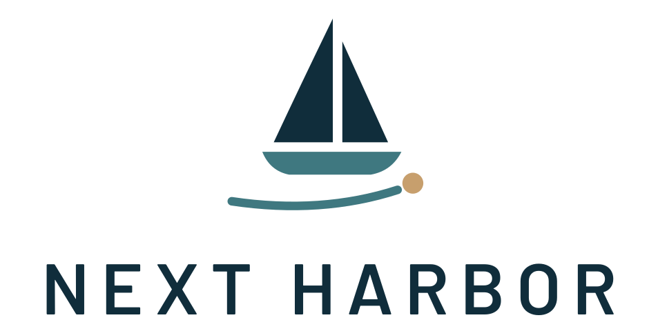

<p align="center">
  <picture>
    <source media="(prefers-color-scheme: dark)" srcset="assets/branding/next_harbor_logo.svg">
    
  </picture>
</p>

# Next Harbor

A 2D liveaboard sailing life simulation. You own a small cruising sailboat and
dream of sailing around the world. The game is about living aboard, planning
voyages and preparing for the next destination, not about steering the boat
across every mile of ocean.

Current state: **Iteration 004b: Cabin Refinement, Companion Animation & Developer
Workflow**, a focused follow-up to Iteration 004 (three boats, the boatyard,
sprite-ready vessel art). Earlier iterations built:
- 003b: ship's cat or dog, adjustable sleep, sail check, chart sidebar, simulation
  pause;
- 003: wind, sails, automatic propulsion;
- 002: sea routes, voyages, game clock, weather warnings;
- 001: boat, menus, save/load, settings, audio.

Iteration 004b adds:
- **the ship's cat drawn by the owner** (`Visuals/Cat/`). It rests, naps on its
  back, stretches now and then, looks up when you come close, and sits up purring
  with hearts when petted. The poses are configured in data, so the art can be
  replaced without code;
- **a refined Halcyon 40 cabin**: a clearly drawn saloon door to the deck, an
  L-shaped galley, a U-settee with table, a nav station, a full-width owner's
  berth, and a guest cabin with heads, shower and bunk;
- **developer guides** in [DEV_GUIDES/](DEV_GUIDES/README.md): practical
  instructions for sprites, companion poses, vessel art, audio and future
  modding, also readable in the game from the main menu in development builds.

Iteration 004 introduced the Starling 33 monohull, the Halcyon 40 catamaran and
the Petrel 36 trimaran, the boatyard, and named visual slots with procedural
fallback art.


## Engine

- **Godot 4.7.2 (stable)**, GDScript only, no plugins or add-ons.
- Renderer: *Compatibility* (OpenGL 3), the most widely supported option for 2D on Windows.
- Reference resolution 1920×1080, stretch mode `canvas_items` / aspect `expand`.
- Target platform: Windows desktop (developed and tested on Linux, see the iteration reports).

## Opening and running

1. Install [Godot 4.7.x](https://godotengine.org/download) (standard build, not .NET).
2. In the Project Manager choose **Import**, select this folder's `project.godot`, and open it.
   The first import takes a few seconds.
3. Press **F5** (Run Project). The main scene is `res://src/app/app.tscn`.

From the command line:

```sh
godot --path .                                           # run the game
godot --headless --path . res://tests/test_runner.tscn   # run the automated tests
```

## Controls

| Action | Keys / mouse |
|---|---|
| Move | **W A S D** or **arrow keys** |
| Interact | **E** (e.g. pet the cat or dog, sleep at the berth, check the sails at the helm, visit the boatyard from the pontoon side of the deck) |
| Boatyard: browse boats | **Up / Down** (or click a boat), **Move aboard …** to choose |
| Pause menu / back | **Esc** |
| Pause / time acceleration | **Pause** and **1× / 5× / 20×** in the time bar at the top (on deck, in the cabin and on the chart). Pause stops the clock; Pause again, or a speed, continues |
| Chart: pan | drag with the mouse, or **W A S D** / arrows |
| Chart: zoom | mouse wheel, **+ / −**, **Page Up / Page Down**, or the toolbar buttons |
| Chart: choose destination | click a port, then **Plot course to …** |
| Chart: add a waypoint | press on the course line and drag |
| Chart: move a waypoint | drag the diamond-shaped waypoint marker |
| Chart: remove a waypoint | right-click it, or select it and press **Delete** / **Remove waypoint** |
| Chart: show/hide wind | **Wind** switch in the toolbar |
| Chart: sleep | **Sleep** button in the side panel |
| Sleep dialog: duration | **<** / **>** buttons (or Left / Right): 1–12 hours |

Menus work with the mouse and keyboard (Tab / arrow keys to move focus, Enter / Space to press).

## Playing a voyage

1. **Plan.** At the **navigation table** in the cabin, press **E** to open the chart of
   Europe. Click a destination port and press **Plot course to …**. The game
   calculates a sea route around coasts and islands, shows its distance and an
   estimated time with the expected wind, and lists any weather along it. The
   chart shows the wind as arrows (pointing where the wind blows) coloured by
   strength; the cursor readout shows the wind under the mouse.

   The sidebar has a header that is always visible (voyage status, distance, ETA)
   and three tabs:
   - **Course:** destination, course and waypoints;
   - **Weather:** the wind at the boat and the weather along the course;
   - **Details:** position, projection and help.

   Its footer always holds **Apply/Change course**, **Discard**, **Set sail**,
   **Sleep** and **Back**.
2. **Adjust (optional).** Drag the course line to add waypoints, drag waypoints to
   move them, right-click to remove them. The legs on either side are recalculated
   at once. A waypoint on land, or a leg that cannot be sailed, is marked **BLOCKED**
   with a red cross and explained in the side panel; such a course cannot be applied.
   Nothing changes until you press **Apply course**. **Discard** returns to the
   current course.
3. **Depart.** Take the **helm** on deck (or press **Set sail** on the chart) and
   confirm. The autopilot sails the course and the boat decides for itself how to
   make way:
   - **Sailing** speed depends on the wind's strength and angle: up to about 10 kn,
     about 3.5 kn in marginal conditions, nothing head to wind.
   - On deck the mainsail and jib are trimmed to the wind on the leeward side.
   - With the wind 115–180° off the bow, the **spinnaker** is set ahead of the bow.
   - When the wind stays too light (averaged over about an hour below 3.5 kn), or
     the boat is becalmed or head to wind for 10 minutes, the **engine** starts:
     5 kn, sails furled, engine sound.
   - The engine stops again once the wind has been good (above 6 kn of sailing
     speed) for a while.

   The HUD shows destination, distance to go, a wind-aware ETA, speed, sail or
   engine with the reason, and the local wind. The pontoon is left behind and the
   chart shows the boat's actual position.

   **Check sail configuration** at the helm (press **E** there while underway) makes
   the boat assess the current heading and wind at once. If the conditions are now
   clearly good or poor, sails or engine change straight away. It is a check, not an
   engine switch: it never forces a mode the conditions don't justify. The usual
   minimum times (15 min under sail, 30 min under engine) still apply, so it cannot
   make the boat switch back and forth. A change of course at sea triggers the same
   check automatically.
4. **Live aboard.** Walk around the cabin and deck while the voyage continues.
   1 real second is 1 game minute at **1×**. Use **5×** or **20×** to go faster, or
   **Pause** to stop the clock: the boat, wind and time wait while you look around
   or plan on the chart. Sleeping still works while paused (it moves time on by the
   hours you choose) and the game stays paused afterwards.
5. **Sleep.** Use the berth in the cabin, or the **Sleep** button on the chart. Choose
   1–12 hours with the arrows. The dialog shows when you will wake. The boat sails
   on while you sleep, and you are woken early on arrival or when a weather warning
   comes in. Wherever you went to sleep, you wake in the cabin beside the V-berth.
6. **Weather.** The chart shows demonstration weather areas (fair, caution, danger).
   When your course will reach a caution or danger area within **5 hours of sailing**
   at the current speed, a warning appears with **View chart** and **Dismiss**.
   Accelerated time drops back to 1×. These areas only produce warnings; the
   boat's speed comes from the wind field.
7. **Change course at sea.** Open the chart while underway, edit the remaining course
   or pick another destination, and press **Change course**. The new course starts
   where the boat is. If no sea route exists, the current voyage is kept unchanged.
8. **Arrive.** On arrival you get a notification, the HUD shows **Arrived at …**, and
   the next voyage starts from there.

## What works

- **Main menu** with the Next Harbor logo: New Game, Continue (most recent valid save),
  Load Game, Settings, Quit.
- **Three boats**, each with its own deck and cabin, player movement, collision and
  interactions (berth, navigation table, helm, companionway, boatyard):
  - **Starling 33**, the monohull you start with: up to 10 kn, 5 kn under engine;
  - **Halcyon 40**, a catamaran with a bridgedeck saloon and two hulls: fast reaching,
    poorer upwind, 6.5 kn under its twin engines;
  - **Petrel 36**, a trimaran with a central cabin hull and two floats: the fastest,
    up to 14 kn, 5.5 kn under its outboard.
- **Boatyard** (in harbour only): the station by the pontoon opens it. It shows each
  boat's preview, hull type, description, specs and a comparison table (top speed,
  speed in 12 kn of wind at 45°, 90° and 150°, engine speed), all computed from the
  boats' sailing data. Changing boats is free and keeps the time, the harbour, the
  companion and your progress; you step aboard on deck. Underway the boatyard is
  closed.
- **European chart** (Iceland to Cyprus, North Cape to North Africa) from Natural Earth
  coastlines. It has zoom, pan, "All Europe", "Find boat", a cursor coordinate readout
  and **15 ports**: Copenhagen, Kiel, Gothenburg, Bergen, Helsinki, Portsmouth, Dublin,
  Brest, Lisbon, Gibraltar, Barcelona, Marseille, Naples, Piraeus and Reykjavík.
- **Sea routing** that never crosses land, through straits such as the Øresund, Great
  Belt, Dover, Gibraltar and Bonifacio. Routes have editable waypoints,
  and distances are measured along the actual course.
- **Game clock** starting Friday 1 May 2026, 08:00 UTC, with 1× / 5× / 20× acceleration.
  It pauses with the pause menu and runs in the cabin, on deck and on the chart.
- **Voyages**: departure, continuous travel, arrival, sleeping, weather warnings and
  changing course at sea.
- **Wind** for all of Europe (25°W–37°E, 33–72°N): deterministic and continuous,
  changing slowly with time, with plausible regional character. Examples: westerlies
  in the Atlantic, northerlies off Portugal, the Mistral and the Meltemi, and a
  lighter, more changeable Baltic. It is shown on the chart with arrows, a speed
  tint and a legend.
- **Sailing and motoring**: wind-dependent speed (up to ~10 kn), an automatic
  sail/engine choice with hysteresis, an automatic spinnaker, sails drawn on deck
  by wind angle and side, and an engine sound loop (loud on deck, muffled below,
  never restarting on scene changes, following the SFX volume).
- **Ship's companion**: on New Game you choose a **cat** or a **dog** (the cat is
  preselected). It lives in the cabin of whichever boat you sail and rests in a few
  spots of its own, moving to another spot every few game hours.
  - The cat is drawn with the owner's artwork in four poses: resting, napping on
    its back, stretching, and alert.
  - Walk up to it and it looks up. Press **E** to pet it: the cat sits up, purrs
    and shows hearts; the dog pants happily.
  - There are no stats, needs or bonuses; it is company.
- **Developer guides** (development builds only): a **Developer guides** button in
  the main menu's top-right corner opens the guides from `DEV_GUIDES/`.
- **Pause menu**, **save/load** (3 slots), **settings** (audio, display, interface scale),
  audio buses and placeholder sounds, as in Iteration 001.

## Saves

- Stored as JSON in Godot's user folder: `user://saves/slot_1.json` … `slot_3.json`.
  On Windows that is `%APPDATA%\Godot\app_userdata\Next Harbor\saves\`.
- A save holds everything needed to resume, including mid-voyage:
  - the game clock and time acceleration;
  - the boat's position and status, and the exact course being sailed with the
    progress along it;
  - sail or engine and the automatic controller's state, and the wind seed;
  - the weather warnings already given;
  - the boat area and player position;
  - the ship's companion (cat or dog, resting spot and when it next moves);
  - the boat you sail (by its stable id, e.g. `halcyon_40`).
- Loading resumes exactly where you saved. **No time passes while the game is closed.**
- Save format version 5. **Older saves still load:**
  - Iteration 003b saves (v4) load aboard the Starling 33 monohull.
  - A save naming a boat this version does not know loads aboard the Starling 33,
    and you are told.
  - Iteration 003 saves (v3) get a ship's cat (the default companion).
  - Iteration 002 saves (v2) keep their voyage. Sail or engine is decided from the
    wind where and when the boat was saved.
  - Iteration 001 saves (v1): the boat is placed in its port at the default start
    time, and an old planned route is recalculated as a sea route. If that is
    impossible, the old route is removed and you are told.
- Writes are safe (temporary file, verify, keep `.bak`, then replace). Damaged or invalid
  saves are reported and never change the running game.

## Settings

Unchanged from Iteration 001: stored in `user://settings.cfg`, separate from saves;
changes preview immediately, **Apply** saves them, **Back** asks before discarding.
Volumes are percentages (0% mutes). Window modes: Windowed, Fullscreen (exclusive),
Borderless fullscreen. Interface scale 80–130% scales menus and HUD only.

## Project layout

```
assets/          branding, fonts (Barlow, OFL), UI theme, placeholder audio,
                 vessel art folders and templates (assets/vessels/<id>/)
data/navigation/ ports, coastlines, navigation raster and sea-route graph (generated)
data/weather/    demonstration weather areas, wind climatology
data/vessel/     sailing performance profiles (polar, engine, controller thresholds)
data/vessels/    vessel definitions, the vessel catalog and visual profiles
src/app/         application shell (main scene) and screen transitions
src/core/        game session state and the simulation (game clock, voyages)
src/boat/        boat area logic, collision fixtures, sail rig, visual slots (visuals/)
src/vessels/     vessel definition and catalog; deck/cabin scenes per vessel (<id>/)
src/companion/   ship's companion: state (kind, resting spot), the cabin animal, pose art data types
src/dev/         developer guide index for the in-game viewer
data/companions/ companion pose sets (cat_visuals.tres: pose -> image, placement, timing)
Visuals/Cat/     the owner's original cat drawings (used directly by the game)
DEV_GUIDES/      practical developer guides (sprites, companion, vessel art, audio, modding)
src/player/      player token
src/interaction/ interactables and the player's interaction sensor
src/navigation/  ports, routes, voyages, projection, sea router, chart screen, chart wind layer
src/sailing/     propulsion state and the automatic sail/engine controller
src/weather/     weather conditions, wind field
src/ui/          menus, HUD, time controls, new-game and sleep dialogs, notifications, dialogs
src/audio/       audio manager
src/persistence/ save manager (format v5 + migration)
src/settings/    settings manager
tests/           self-contained test runner and suites
tools/           generators for the theme, logo exports, placeholder audio, navigation data,
                 vessel scenes, art templates and the demo sprite (tools/vessels/)
docs/            screenshots
```

**Developer guides:** [DEV_GUIDES/README.md](DEV_GUIDES/README.md) is the practical
manual for replacing art and sounds, the companion poses, and the vessel art
templates. **Rule:** whenever an iteration changes an asset workflow or a
documented system, the matching guide is updated in the same iteration.

See [ARCHITECTURE.md](ARCHITECTURE.md) for how it fits together, and
[ITERATION_004B_REPORT.md](ITERATION_004B_REPORT.md) (and the reports for
[004](ITERATION_004_REPORT.md),
[003b](ITERATION_003B_REPORT.md), the [003b hotfix](ITERATION_003B_UI_HOTFIX_REPORT.md),
[003](ITERATION_003_REPORT.md),
[002](ITERATION_002_REPORT.md) and [001](ITERATION_001_REPORT.md)) for what was
built and verified.

## Known limitations

- The wind is synthetic, not real weather and not a forecast. Sailing is simplified:
  - there is no manual sail or engine control (the helm only asks for a fresh
    check), no tacking (a head-to-wind leg is motored), and no fuel;
  - there are no currents, waves, depth or tides;
  - the weather areas are static demonstration data and only produce warnings;
  - the ETA is an estimate along the route with the expected wind. It ignores the
    controller's delays.
- The companion only rests and changes pose (no walking, no needs) and stays in the
  cabin. Its sounds are synthetic placeholders. The dog has no drawn artwork yet
  (it uses the placeholder drawing).
- **Routing coverage.** All 15 ports are reachable from each other. Waters the chart
  data cannot represent are **not** navigable, and are reported as such instead of being
  crossed. These include:
  - the Black Sea, Sea of Marmara and Sea of Azov (the Bosporus and Dardanelles are too
    narrow for the data);
  - the Gulf of Corinth, the White Sea and the inner Oslofjord;
  - the inner Stockholm archipelago and many small sounds and fjords.

  Oslo and Stockholm are therefore not in the port list. Canals such as the Kiel Canal
  are not modelled.
- Harbour coordinates often sit on generalised coastline. Each port gets a **bounded
  harbour approach**: up to 2 nm from the berth and at most 10 nm through mostly-water
  cells, which may graze the simplified coastline. All other legs stay strictly clear of land.
- The chart and the save files are game data, **not for real navigation**.
- All audio is temporary synthetic test sound. Boat graphics are still procedural
  placeholders: the sprite pipeline is ready, but only one demo sprite exists (the
  Starling's coachroof, not enabled by default).
- Boats are only swapped, never bought: there is no money, maintenance, upgrades or
  decoration yet. The catamaran's and trimaran's layouts are first versions.
- Tested on Linux with Godot 4.7.2 (headless and under a virtual display with software
  OpenGL). Not run on Windows yet. VSync could not be verified in that environment.

## Credits and licences

- Coastlines: [Natural Earth](https://www.naturalearthdata.com/) 1:10m land, public domain.
  Clipped, simplified and rasterised by `tools/navigation/build_navigation_data.py`,
  **not for navigation**.
- Font: [Barlow](https://github.com/jpt/barlow) by Jeremy Tribby, SIL Open Font License
  (`assets/fonts/OFL.txt`).
- Logo, UI, scenes, weather areas and placeholder sounds were made for this project.
